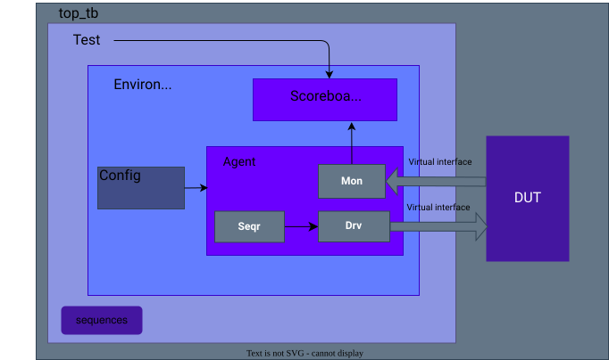

# uvm-uart

Worked example 2 of the [SiliconBadgers UVM training](https://github.com/ihagedo/uvm-training). A complete UVM testbench for a UART receiver and transmitter: an agent with a configuration object, a driver and monitor that speak a serial protocol, a scoreboard, and a directed test. Read it, run it, then change it.



## Run it

From a `uvm-training` checkout (`git clone --recurse-submodules git@github.com:ihagedo/uvm-training.git`):

```bash
cd examples/uart
make run                 # Verilator (default)
make run SIM=questa      # or xcelium, vcs
make waves               # FST waves; open with gtkwave
make gui SIM=questa      # Questa GUI with waves
```

Set up the tools first; see the `uvm-training` README. Outside `uvm-training`, point `UVM_HOME` at the `src/` directory of a UVM 1.2 checkout.

A passing run ends with `4 data passed!` and `PASS tc_direct_urx_utx`.

## Layout

| Path | Contents |
|---|---|
| `rtl/` | The DUT: a UART from CHIPKIT (see `rtl/README.md`) |
| `agent/` | The UART agent: interface, config, sequence item, sequence, sequencer, driver, monitor, agent, package |
| `environment/` | Environment and scoreboard |
| `test/` | Base test, directed test, and the verification package |
| `top_tb/` | Top module: clock, reset, DUT, `run_test()` |
| `docs/` | Block diagram (`uvm.drawio` is the source) |

## Walkthrough

Read the files in this order. Each step answers one question.

1. **What is the DUT?** `rtl/README.md`, then the port list of `rtl/uart.sv`. `top_tb` loops the receiver back into the transmitter, so every byte sent in should come back out.
2. **How does the testbench reach the DUT?** `agent/uart_if.svh` and `top_tb/top_tb.sv`. The top module puts the interface in `uvm_config_db`, and `env_top` gets it back.
3. **What is a transaction?** `agent/uart_seqit.svh`. `data_arr` is what the driver sends; `mon_data` is what the monitor saw. `do_compare` defines what "equal" means.
4. **How is the agent configured?** `agent/uart_config.svh` and `env_top::configuration()`. One config object holds the virtual interface and the protocol settings, and the agent hands it to the driver and monitor.
5. **How does stimulus reach the pins?** `agent/uart_sequence.svh` → `agent/uart_sequencer.svh` → `agent/uart_driver.svh`. The driver turns each byte into start, data, parity, stop and idle bits.
6. **How is the output observed?** `agent/uart_monitor.svh`. It waits for a start bit, samples each bit in its middle, checks parity and stop bits, and writes a transaction to its analysis port.
7. **How is it checked?** `environment/uart_scoreboard.svh`. The test preloads the expected bytes; the scoreboard compares each observed byte in order and, in `check_phase`, reports any expected byte that never arrived.
8. **How is a test put together?** `test/test_top.svh` (builds the environment) and `test/tc_direct_urx_utx.svh` (runs the sequence and preloads the expected data).

## Exercises

1. **Break the protocol.** Set `stop_bit = STOP_BIT_ONEBIT` in `env_top::configuration()`. Does the test still pass? Why?
2. **Why the idle bit?** Set `idle_bits = 0` in `agent/uart_config.svh` and run on two simulators. Explain from `rtl/README.md` why a byte is lost and why the result can change with time precision.
3. **Add a test.** Write `tc_random_bytes` that sends 20 random bytes and preloads them as expected data. Include it in `test/verif_pkg.svh` and run `make run TEST=tc_random_bytes`.
4. **Close the loop.** Have the driver write each byte it sends to an analysis port and connect it to the scoreboard's `expected` export, so tests no longer preload expected data.

## Using the agent in your own testbench

- Include the interface and package files in your top-level testbench module:

```verilog
`include "uart_if.svh"
`include "verif_pkg.svh"
module top_tb;
  import uvm_pkg::*;
  import verif_pkg::*;
```

- Instantiate the interface, drive the reset and clock signals, and connect it to the DUT:

```verilog
uart_if uart_if_inst(
  .resetn_i (resetn_i),
  .clock_i  (clock_i)
);

uart uart_rx_CHIPKIT_inst(
  .clk  (uart_if_inst.clock_i),
  .rstn (uart_if_inst.resetn_i),
  ...
);
```

- Register the interface in `uvm_config_db` and call `run_test()`:

```verilog
initial begin
  uvm_config_db #(virtual uart_if)::set(null, "*", "uart_vif", uart_if_inst);
  run_test();
end
```

- In the environment, construct the config, agent and scoreboard in `build_phase`, get the virtual interface into the config, and pass the config down:

```verilog
uart_agent_config_h = uart_config::type_id::create("uart_agent_config_h", this);
uart_agent_h        = uart_agent::type_id::create("uart_agent_h", this);
uart_scoreboard_h   = uart_scoreboard::type_id::create("uart_scoreboard_h", this);
if (!uvm_config_db #(virtual uart_if)::get(this, "", "uart_vif", uart_agent_config_h.vif))
  `uvm_fatal("VIF CONFIG", "cannot get uart_vif from uvm_config_db")
uvm_config_db #(uart_config)::set(this, "uart_agent_h",      "uart_config", uart_agent_config_h);
uvm_config_db #(uart_config)::set(this, "uart_scoreboard_h", "uart_config", uart_agent_config_h);
```

- Connect the monitor to the scoreboard in `connect_phase`:

```verilog
uart_agent_h.monitor_h.monitor_port.connect(uart_scoreboard_h.observed);
```

- Set the agent's protocol parameters:

```verilog
uart_agent_config_h.baud_rate        = 115_200;
uart_agent_config_h.number_data_bits = EIGHT_WIDTH;
uart_agent_config_h.reset_polarity   = ACTIVE_LOW;
uart_agent_config_h.stop_bit         = STOP_BIT_TWOBITS;
uart_agent_config_h.parity_bit       = PARITY_NONE;
```

## Configuration fields (types in `agent/typedefs.svh`)

| Name | Default in `uart_config` | Set by `env_top` |
|---|---|---|
| `reset_polarity` | `ACTIVE_LOW` | `ACTIVE_LOW` |
| `baud_rate` | 115 200 | 115 200 |
| `number_data_bits` | `EIGHT_WIDTH` | `EIGHT_WIDTH` |
| `stop_bit` | `STOP_BIT_ONEBIT` | `STOP_BIT_TWOBITS` |
| `parity_bit` | `PARITY_ODD` | `PARITY_NONE` |
| `idle_bits` | 1 | (default) |

## Adding a test

Include the new test in `test/verif_pkg.svh` and select it with `TEST=`:

```verilog
`include "../test/tc_direct_urx_utx.svh"
`include "../test/your_new_testcase.svh"
```

```bash
make run TEST=your_new_testcase
```

## History

Moved here from `ihagedo/uvm-training` (commit `f7b7553`), which now collects the examples as submodules. The RTL used to come from a CHIPKIT submodule; it is now copied into `rtl/`.
